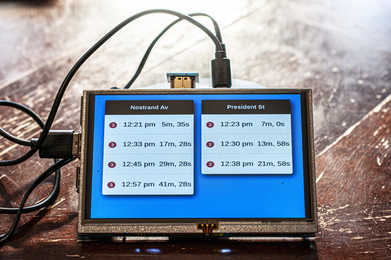

# NYC Subway Countdown Clock

An always-on arrival board for New York City subway stations, designed for a browser, an old laptop, or a Raspberry Pi connected to a small monitor.

**Select your station platforms, start one Node.js process, and open the page.** The app fetches the MTA's official GTFS-Realtime subway feeds and shows the next arriving trains, sorted by ETA. You can track two platforms side by side, or as many as 20. The board updates every 20 seconds and counts down locally every second.



> **Version 2.0 — complete rewrite.** This replaces the previous TypeScript/Express/Webpack application and its standalone HTML/jQuery page. It runs directly on a currently supported Node.js LTS release without installing third-party runtime or development packages. A native test suite, HTTP health endpoint, error handling, and GitHub Actions CI are included.

## What it does

- Shows real-time arrival predictions for **multiple subway platforms**, not just two.
- Supports all of the MTA's main subway GTFS-RT feeds: 1–6, 7, A/C/E, B/D/F/M, G, J/Z, L, N/Q/R/W. The Staten Island Railway feed can be selected separately.
- Decodes MTA's binary GTFS-Realtime responses directly. Each feed is requested **once per refresh**, rather than duplicating requests.
- Filters by the exact stop/platform IDs you configure, removes duplicate predictions, ignores past predictions, and sorts by arrival time.
- Displays line-colored route markers, northbound/southbound station labels, NYC-local arrival times, and a one-second countdown.
- Handles partially unavailable feeds without discarding results from healthy feeds. If all feeds fail, the API reports a service outage rather than pretending no trains are coming.
- Uses a 20-second in-memory cache and coalesces simultaneous incoming browser requests, so several clients don't multiply MTA requests.
- Runs frontend and API on **the same port**, without CORS configuration or browser access to the MTA.
- Includes automated tests, a lightweight health-check endpoint, strict startup validation, and secure HTTP response headers.

## Requirements

- **Node.js 22.16+** (Node.js **26 LTS** recommended as of November 2026). [Install Node.js](https://nodejs.org/en/download).
- Network access to `https://api-endpoint.mta.info/` to retrieve live subway predictions.
- Any modern browser (Chromium on Raspberry Pi works well).

**No MTA API key is required.** The MTA now publishes its subway GTFS-Realtime feeds without accounts or API keys. If you used the original app, you do **not** need to carry over `MTA_API_KEY`. See the [MTA developer portal](https://api.mta.info/) for the current feed list and requirements.

## Quick start

```bash
# Clone the project, or extract the supplied ZIP.
git clone https://github.com/edwarddistel/mta-countdown-clock.git
cd mta-countdown-clock

# Requires a recent Node.js release. npm ci is optional (there are zero dependencies).
node --version
cp .env.example .env

# Edit .env to select your station platforms and feeds.
npm start
```

Then open **http://127.0.0.1:4000/** on that machine. The arrival API is available at **http://127.0.0.1:4000/api/arrivals**.

The included sample configuration tracks the northbound and southbound **7 train at Times Sq–42 St**:

```dotenv
STATIONS="725N 725S"
FEEDS="7"
PORT=4000
HOST=127.0.0.1
REFRESH_SECONDS=20
MAX_TRAINS=6
```

Use `npm run dev` for automatic server restart when backend files change. The page itself is plain HTML/CSS/JavaScript and can be edited without a build step.

## Picking stations and platforms

1. Open [`data/stations.json`](data/stations.json) and search for the station name (for example, `Times Sq - 42 St`).
2. Identify the **platform** IDs ending in `N` (northbound / uptown) or `S` (southbound / downtown). A station complex may have several different base IDs for different sets of tracks.
3. Put the exact platform IDs in `STATIONS`, separated by spaces or commas.
4. Choose the corresponding `FEEDS` groups using the table below. Some stations serve trains from different feed groups, so you may need more than one.

For instance, the Times Square complex includes multiple station IDs for different platforms. `725N 725S` refer to the 7 train's platforms, not every route that serves Times Square. To see all its routes, add the other relevant platform IDs and feed groups.

**Station data note:** `data/stations.json` is preserved from the previous repository and is a historical snapshot of MTA stop metadata, not a continuously updated station directory. If an MTA station or stop ID has changed, update the file from the [MTA subway GTFS static dataset](https://api.mta.info/) before selecting that ID. The application validates IDs against this local file.

### Available feed groups

| `FEEDS` value | Routes | Official GTFS-RT feed path |
| --- | --- | --- |
| `123456` | 1, 2, 3, 4, 5, 6, some shuttles | `/nyct/gtfs` |
| `7` | 7 | `/nyct/gtfs-7` |
| `ace` | A, C, E | `/nyct/gtfs-ace` |
| `bdfm` | B, D, F, M | `/nyct/gtfs-bdfm` |
| `g` | G | `/nyct/gtfs-g` |
| `jz` | J, Z | `/nyct/gtfs-jz` |
| `l` | L | `/nyct/gtfs-l` |
| `nqrw` | N, Q, R, W | `/nyct/gtfs-nqrw` |
| `si` | Staten Island Railway | `/nyct/gtfs-si` |

All paths above share this base URL: `https://api-endpoint.mta.info/Dataservice/mtagtfsfeeds`. If `FEEDS` is not set, the app requests the eight standard subway groups (all groups except `si`). To avoid unnecessary network traffic, **set only the relevant feed groups** in your `.env` file, such as `FEEDS="7,ace,nqrw"`.

## Configuration reference

The `.env` file is loaded by Node itself using `--env-file-if-exists` (no `dotenv` dependency). A normal shell environment variable takes precedence over the file's value.

| Variable | Default | Description |
| --- | --- | --- |
| `STATIONS` | `725N 725S` | One to 20 known platform IDs, space- or comma-separated |
| `FEEDS` | Eight subway groups | Space- or comma-separated feed group keys from the table |
| `HOST` | `127.0.0.1` | Local-only by default; set `0.0.0.0` to serve other LAN devices |
| `PORT` | `4000` | HTTP port, 1–65535 |
| `REFRESH_SECONDS` | `20` | Shared in-memory cache duration, 10–300 seconds |
| `MAX_TRAINS` | `6` | Maximum displayed predictions per platform, 1–20 |
| `FETCH_TIMEOUT_MS` | `8000` | Timeout per upstream feed, 1000–30000 ms |

**Security:** Keep `HOST=127.0.0.1` when the server and display run on the same device. `0.0.0.0` exposes the HTTP server to your local network. This project deliberately has no user authentication; **do not expose its port directly to the public internet**. The repository does not contain or require secrets.

## API

| Endpoint | Purpose |
| --- | --- |
| `GET /` | Full-screen arrival board |
| `GET /api/arrivals` | JSON arrival predictions |
| `GET /api` | Alias for the JSON endpoint |
| `GET /healthz` | Local server liveness check; does *not* call the MTA |

Example response (illustrative; times vary):

```json
{
  "status": "ok",
  "fetchedAt": "2026-11-20T18:00:00.000Z",
  "refreshSeconds": 20,
  "stations": {
    "725N": {
      "name": "Times Sq - 42 St",
      "direction": "Uptown / northbound",
      "trains": [
        {
          "trainId": "7",
          "tripId": "example-trip",
          "arrivesAt": "2026-11-20T18:03:12.000Z",
          "secondsAway": 192,
          "eta": "1:03 pm",
          "minAway": "3m, 12s",
          "rawEta": 192
        }
      ]
    }
  },
  "feeds": { "requested": 1, "succeeded": 1, "failed": [] }
}
```

The new API retains `stations`, `name`, `trains`, `trainId`, `eta`, `minAway`, and `rawEta` from the original format. It adds `status`, `fetchedAt`, `direction`, `tripId`, `arrivesAt`, `secondsAway`, and `feeds` metadata. The former API lived at `/`; v2 serves its browser display there and puts JSON at `/api/arrivals` or `/api`, so adjust any existing clients accordingly.

`status` can be `ok` (all feeds succeeded), `partial` (some feeds failed, HTTP 200), or `error` (all feeds failed, HTTP 503). `feeds.failed` lists the feed groups that could not be retrieved or decoded. A successful request returning no predictions for a platform is **not necessarily a service outage**; some trips may be absent from the feed.

`arrivesAt` is an absolute timestamp. Use it when building your own display so countdown timers remain accurate between network refreshes. `eta` is formatted in the **America/New_York** time zone, regardless of the server's local time zone.

## Raspberry Pi: an always-on wall clock

These instructions target a current **Raspberry Pi OS with Desktop** install and a display connected to the Pi. A Pi 3/4/5 with enough memory for Chromium is recommended; older Pi models may struggle with a modern graphical browser. Use a stable power supply and a supported Raspberry Pi OS image.

### 1. Set up the Pi

Install Raspberry Pi OS with Desktop using the official [Raspberry Pi Imager](https://www.raspberrypi.com/software/). Create your own user and password, connect to Wi-Fi or Ethernet, and enable SSH if you want remote administration. After boot, open Terminal and update packages:

```bash
sudo apt update
sudo apt full-upgrade -y
sudo reboot
```

### 2. Install a supported Node.js LTS release

Use a supported Node.js 22.16+ binary from [nodejs.org](https://nodejs.org/en/download), or a package manager appropriate for your Pi's CPU architecture and OS. The recommended release line is Node.js 26 LTS (verify that an ARM build is available for your Pi). Avoid the ancient Node 10/12/14 instructions from the old README.

Check the installed binary path, since the service file will need it:

```bash
node --version
command -v node
```

### 3. Put the application on the Pi

For example, in your home folder:

```bash
cd ~
git clone https://github.com/edwarddistel/mta-countdown-clock.git
cd mta-countdown-clock
cp .env.example .env
nano .env
npm run check
npm start
```

Open `http://127.0.0.1:4000/` in Chromium on the Pi to confirm that the board renders. The first request may take several seconds while upstream feeds load. Use `Ctrl+C` to stop the foreground server before setting up the service.

### 4. Run it automatically with systemd

Find your username (`whoami`), absolute project directory (`pwd`), and absolute Node binary (`command -v node`). Create the service:

```bash
sudo nano /etc/systemd/system/mta-countdown-clock.service
```

Replace `YOUR_USER`, `/home/YOUR_USER/...`, and `/usr/bin/node` as appropriate:

```ini
[Unit]
Description=MTA Subway Countdown Clock
Wants=network-online.target
After=network-online.target

[Service]
Type=simple
User=YOUR_USER
WorkingDirectory=/home/YOUR_USER/mta-countdown-clock
ExecStart=/usr/bin/node --env-file-if-exists=/home/YOUR_USER/mta-countdown-clock/.env /home/YOUR_USER/mta-countdown-clock/src/server.js
Restart=on-failure
RestartSec=5
Environment=NODE_ENV=production
NoNewPrivileges=true
ProtectSystem=full
ProtectHome=read-only

[Install]
WantedBy=multi-user.target
```

Then run:

```bash
sudo systemctl daemon-reload
sudo systemctl enable --now mta-countdown-clock
sudo systemctl status mta-countdown-clock
curl -f http://127.0.0.1:4000/healthz
curl -f http://127.0.0.1:4000/api/arrivals
```

Follow logs when troubleshooting:

```bash
journalctl -u mta-countdown-clock -f
```

If your Node executable lives inside `~/.nvm`, it won't necessarily be available under `/usr/bin/node`; set `ExecStart` to its full path. `ProtectHome=read-only` allows reading files in your home directory but prevents the service from modifying them.

### 5. Open Chromium in kiosk mode on login

Make sure Chromium is installed; its command may be `chromium` or `chromium-browser` depending on Raspberry Pi OS. First test manually:

```bash
chromium --kiosk --no-first-run http://127.0.0.1:4000/
```

**Raspberry Pi OS desktop sessions differ by release.** On current Wayland/labwc desktops, configure your user's autostart file (typically `~/.config/labwc/autostart`) to launch Chromium on login. For an LXDE/X11 installation, a `.desktop` entry in `~/.config/autostart/` may be appropriate instead. Consult your installed Raspberry Pi OS release's desktop autostart documentation. The command to add is:

```bash
chromium --no-first-run --noerrdialogs --disable-session-crashed-bubble --kiosk http://127.0.0.1:4000/ &
```

Enable automatic desktop login for the kiosk user, then reboot. The service starts the backend automatically; desktop autostart opens the frontend. Neither step needs a `file://` page, a separate web server, or a reverse proxy.

## Development and tests

```bash
npm ci                 # Optional; installs zero packages and validates package-lock.json
npm run lint           # Syntax-check every production, browser, and test JavaScript file
npm test               # Node's built-in test runner
npm run test:coverage  # Built-in test coverage report
npm run check          # Syntax checks + automated tests
npm run dev            # Restart server automatically when backend files change
```

Tests cover configuration, GTFS-RT protobuf parsing, skipped/canceled trains, ETA calculations, deduplication, sorting, partial outages, caching, concurrency, HTTP endpoints, security headers, and error statuses. They use fixture-encoded GTFS-Realtime messages and mocked HTTP responses, so they **do not depend on MTA uptime or live API keys**. `.github/workflows/ci.yml` runs checks on Node.js 22, 24, and 26.

### Project layout

```text
├── .github/workflows/ci.yml  # CI across supported Node LTS lines
├── .env.example              # Sample stop / feed selection, no credentials
├── data/stations.json        # Stop ID metadata from the original project
├── docs/                     # Historic Raspberry Pi photo
├── public/                   # Browser display: HTML, CSS, JS, favicon
├── scripts/check.js          # Syntax validation
├── src/
│   ├── arrivals.js           # Station aggregation, sorting, and formatting
│   ├── config.js             # Validated settings and official feed URLs
│   ├── feeds.js              # Concurrent fetch, timeouts, error isolation
│   ├── protobuf.js           # Focused GTFS-RT binary field decoder
│   ├── server.js             # Built-in HTTP server, static pages and JSON
│   ├── service.js            # Data refresh and TTL cache
│   └── stations.js           # Stop names and direction labels
└── test/                     # Deterministic unit and HTTP integration tests
```

### Why there are no npm dependencies

The original stack was tied to Node 14, Express 4, Axios 0.x, TSLint, old TypeScript/Webpack versions, and a discontinued TypeScript loader. This rewrite removes **all** of those packages rather than carrying forward unnecessary attack surface. Modern Node provides `fetch`, a production-capable HTTP server, `.env` loading, the `node:test` runner, and a JavaScript syntax checker. A small focused GTFS-Realtime decoder handles only the fields needed for subway countdowns; it is tested against wire-format fixtures and ignores unknown protobuf fields.

There is **no webpack bundle, transpilation step, TypeScript compiler, installed protobuf package, or npm dependency graph to maintain**. The recommended Node 26 LTS release is current for November 2026, while older supported runtimes can still run this code. If you want to add richer GTFS-RT features in the future, consider adopting an actively maintained generated protobuf binding at that point rather than expanding the focused decoder indefinitely.

## Troubleshooting

**Page loads but has no trains.** Check your `STATIONS` and `FEEDS` values, and look at `/api/arrivals`. The platform IDs must match the selected feed groups. If all feeds succeeded but a station is empty, the MTA may currently have no arrival predictions there.

**`status: partial` or `status: error`.** Some or all upstream feeds returned an HTTP error, a timeout, or invalid binary. Check `/api/arrivals` under `feeds.failed`, your internet connection, and the application logs. A successful `/healthz` only means the local HTTP server is running.

**`Unknown stop IDs in STATIONS`.** Use a platform ID from `data/stations.json`, e.g. `725N`, not just the parent station `725` unless that exact value is present and intended. Current MTA stop IDs may have changed since this original snapshot was captured.

**Other devices can't open the board.** The default host binds to loopback for safety. Set `HOST=0.0.0.0` and restart the server. Then open `http://PI_LOCAL_IP:4000/` on devices in the same trusted LAN. Check your firewall first, and do not forward that port to the public internet.

**Node cannot parse `--env-file-if-exists`.** You're running an older Node release. Upgrade to Node 22.16+ (ideally Node 26 LTS), as described under Requirements.

**Chromium doesn't start after reboot.** Check whether your Pi OS desktop uses Wayland/labwc or X11/LXDE; put the kiosk command into that session's autostart configuration and verify graphical auto-login is enabled.

## Data sources and licensing

Arrival predictions: [MTA developer portal](https://api.mta.info/) and the [official GTFS-Realtime specification](https://gtfs.org/documentation/realtime/proto/). The local station metadata originates from the previous version of this repository. Real-time data are supplied by the MTA; this is an independent hobby project and not an official MTA product.

Project license: **ISC**, matching the previous repository.
